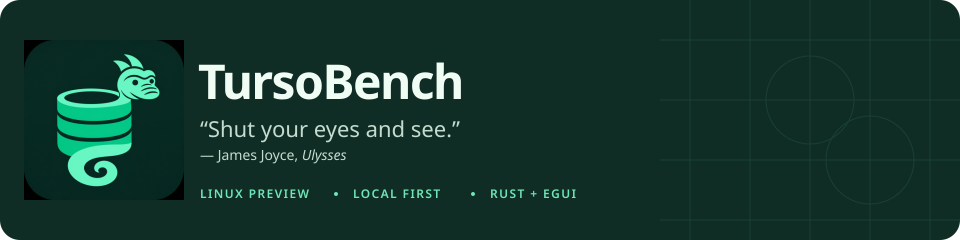
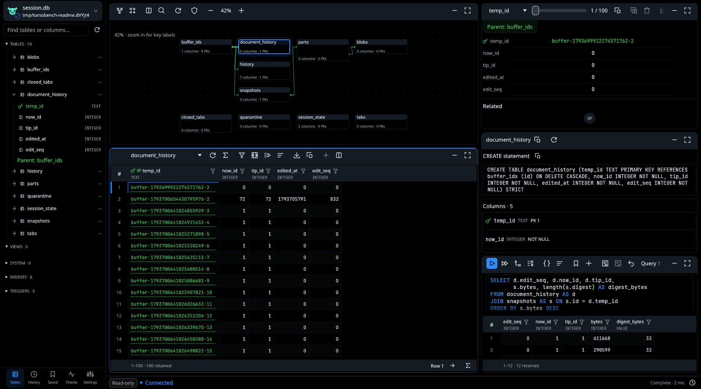
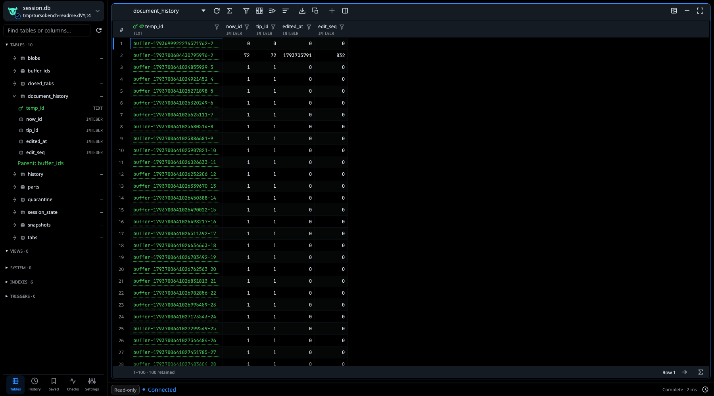
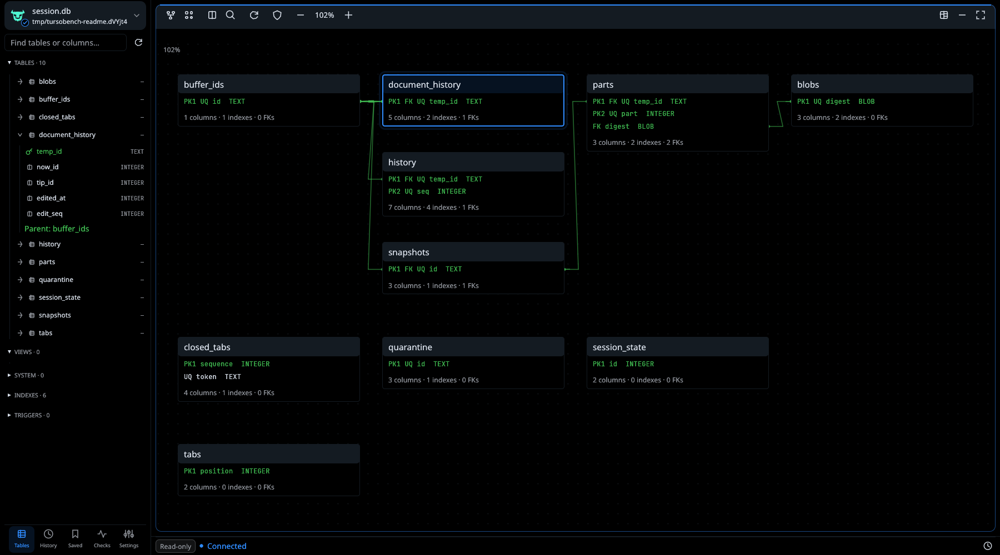
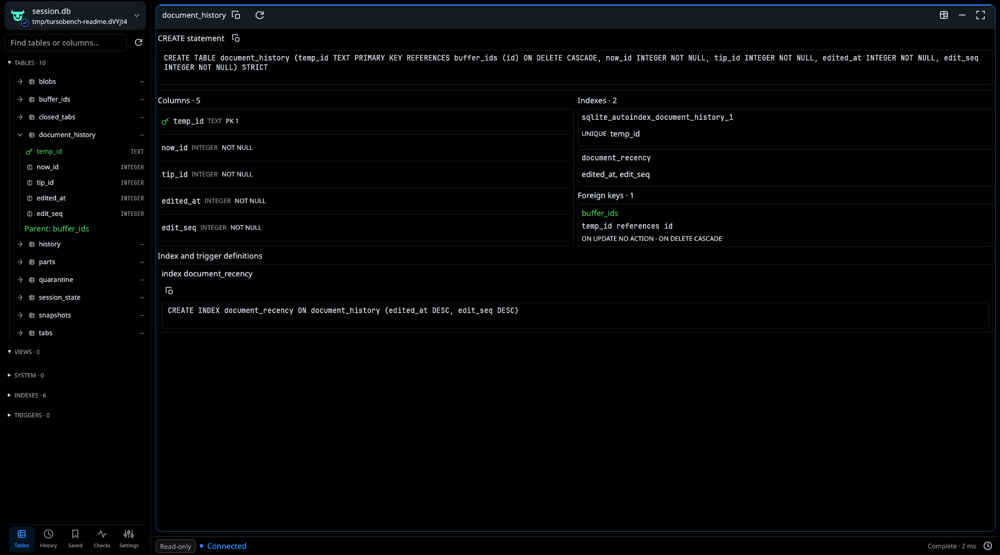
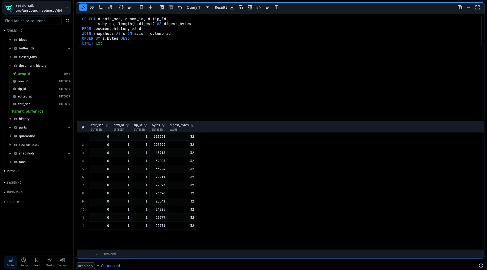
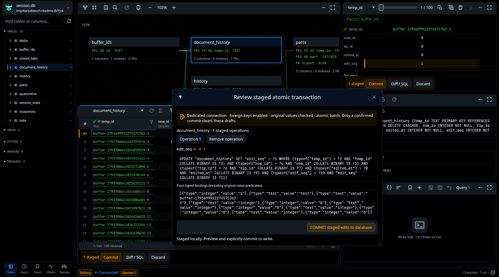
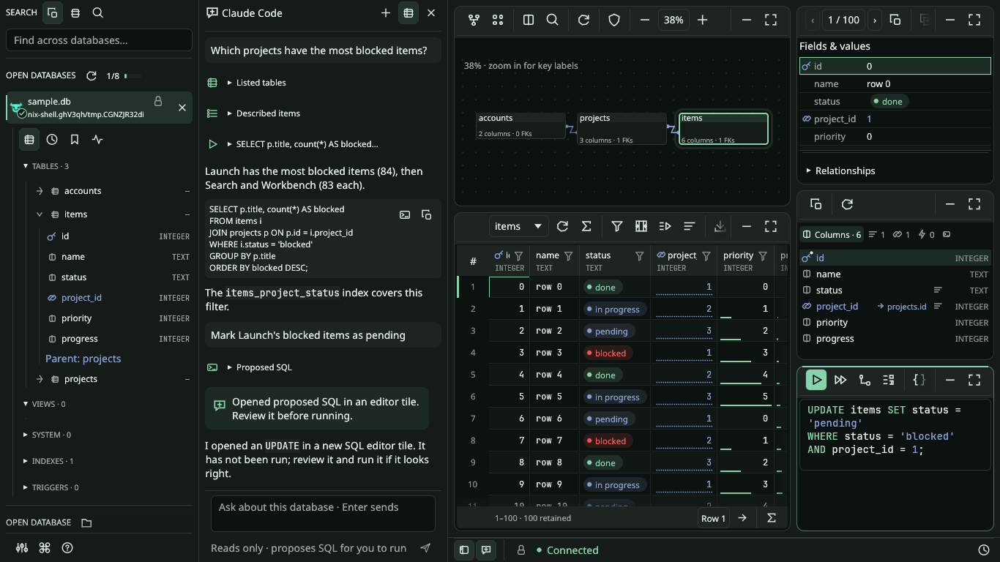
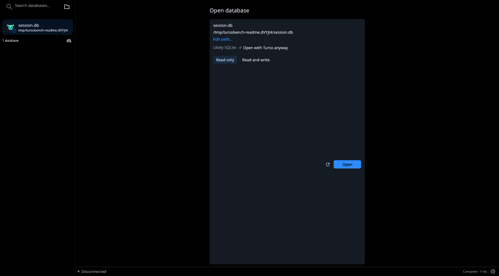

<p align="center">
  <a href="packaging/tursobench.png">
    
  </a>
</p>

<p align="center">
  <a href="#workspace">Workspace</a> ·
  <a href="#browse-and-inspect">Browse</a> ·
  <a href="#sql-and-results">SQL</a> ·
  <a href="#assistant">Assistant</a> ·
  <a href="#run">Run</a> ·
  <a href="#current-limits">Limits</a> ·
  <a href="docs/guide.md">User guide</a>
</p>

TursoBench opens existing local files through Turso.
Connections default to engine-enforced read-only access.
Writes require explicit read/write access. Compatible local peers can share a database.

Rust 1.95 · egui 0.37 · Turso 0.8.3 · Native Wayland · Linux preview

Independent project. Not affiliated with the Turso team.

## Workspace

Each database workspace has five fixed tiles sharing its own database session.
Open multiple databases within a configurable memory budget and switch from the
sidebar or with Ctrl PageUp/PageDown. Settings → Resources shows the memory estimate and effective limit; hover its recommendation tick for startup RAM.
Resize the dividers. Expand a tile or minimize it to a header.
Keep table browsing, typed records, structure, relationships and SQL together.
External commits refresh clean views while drafts and SQL results stay retained.



Screenshots use an offline copy of the same local session database as the earlier demo.
[Capture provenance](docs/assets/ui/README.md#current-readme--native-wayland).

## Browse and inspect

### Table data

Browse virtualized rows in 100-row fetches.
Combine typed filters, grouped expressions and column sorting.
Resize or hide columns. Select ranges. Inspect typed records.
Follow foreign keys and incoming references to related rows.



### Relationships

Inspect declared foreign-key edges and key labels.
Pan, zoom and arrange the graph.
Node positions persist between sessions.



### Structure

Read original DDL, declared types and constraints.
Inspect composite keys, indexes and foreign-key actions.
Copy definitions directly.



## SQL and results

Execute parsed SQL with typed named or positional bindings.
Run the buffer, selection or current statement.
Run all offers sequential or atomic scripts with per-statement outcomes.
Keep separate query documents, linked results, history and saved queries.
Parameters accept ordinary JSON and explicit tagged types; statement deadlines
default to 30 seconds and apply after opening the session.

```sql
SELECT d.edit_seq, d.now_id, d.tip_id,
       s.bytes, length(s.digest) AS digest_bytes
FROM document_history AS d
JOIN snapshots AS s ON s.id = d.temp_id
ORDER BY s.bytes DESC
LIMIT 12;
```



SQL documents recover after restart without restoring bindings or executing SQL.
Completion resolves cached aliases and simple CTEs. EXPLAIN offers plan diagnostics
and conservative index drafts for review.
CTEs, PRAGMAs and `RETURNING` are supported.
Native Turso full-text search uses `USING fts(...)` and `fts_match(...)`.
[FTS reference](docs/fts.md).

Checks offers exact or prefix-sampled data profiles and a scoped PRAGMA dashboard.
F7 compares two open schemas and opens guarded additive migration drafts in the
target editor. Destructive and ambiguous changes retain manual guidance.
[Comparison and migration limits](docs/guide.md#schema-comparison-and-migration-drafts).

## Editing, transactions and export

Stage inserts, updates and deletes locally.
Paste spreadsheet ranges or mapped new rows, fill selected cells, and undo each
paste or fill as one local operation. [Spreadsheet editing](docs/guide.md#spreadsheet-editing).
Review diffs, SQL and exact bindings.
Commit applies an atomic batch with original-value conflict checks.
Failed commits retain drafts.



Editor SQL autocommits unless a transaction is open.
`BEGIN`, `COMMIT` and `ROLLBACK` use the persistent editor connection.
Browsing uses a separate connection and sees committed state.

Export retained values as typed JSONL/JSON, standard or annotated/protected CSV/TSV,
or SQL INSERTs.
Exports exclude staged overlays.
Retained-result exports never rerun SQL or overwrite existing files.
The separate transfer panel offers complete-table and execute-once query JSONL
exports, mapped imports, explicit checkpoint and coordinated verified backup.
Large values have a bounded text/hex viewer and exact-byte save.

Preferences, history and layouts use an application-owned local Turso database
at `~/.config/tursobench/preferences.db` (or under `XDG_CONFIG_HOME`).
[Storage details](docs/data-formats.md).

## Assistant

Ask about the open database in a chat panel beside the sidebar. It runs the
agent CLI you already use and are signed in to: Claude Code by default, or Copilot
CLI, Codex or another Agent Client Protocol agent. TursoBench never handles your
sign-in or an API key. Each database asks once whether to share the schema only
or also query results. The agent reads through a separate `query_only`
connection and cannot write; it proposes SQL that opens in an editor tile for you
to run. Settings → Assistant → Privacy sets, per agent, whether its CLI may send
telemetry, keep the conversation in its history or learn the database's file
name; all are off by default except the file name. Ctrl B and Ctrl I hide or
show the sidebar and the assistant independently.



[Assistant guide](docs/guide.md#assistant) · [Assistant contract](contracts/assistant.md)

## Run

Use the Nix development shell:

```sh
nix develop -c cargo run --locked -p tursobench-ui -- /path/to/session.db
```

Or use the pinned Rust toolchain:

```sh
cargo run --locked -p tursobench-ui -- /path/to/session.db
```

Omit the path to open the chooser.
The default Linux build requires native Wayland and OpenGL/EGL.
Hyprland is the primary development desktop.
X11 is an [opt-in compatibility build](docs/guide.md).
Use the desktop file picker or enter a path directly.
Open never creates a database.
Search discovered or recent files, choose access and review blocking failures inline.



## Current limits

- **Shared local access.** Compatible Turso 0.8.3 peers can share readers and serialized writers on Linux. Legacy writers are rejected; standalone read-only access blocks writers until closed. [Protocol and limits](docs/shared-access.md). Cloud sync and encryption remain unsupported.
- **Turso only.** SQLite headers indicate possible compatibility. No alternative engine is selected.
- **Bounded delivery.** Queries default to 1,000 rows, 8 MiB per result and 64 KiB per inline cell. Larger values use bounded deferred storage. Engine memory is not bounded.
- **Paging.** Suitable non-null keys use keyset paging; fallback deep offsets may be slow. Browsing is not snapshot-consistent.
- **Explicit writes.** Generated edits require suitable primary-key base tables. Arbitrary results, keyless tables, `WITHOUT ROWID` tables and generated columns remain read-only.
- **Execution outcomes.** Discard can interrupt supported reads; writes finish when output is discarded. Cooperative deadlines do not prove rollback. Close waits for execution and cleanup acknowledgement.

The [review implementation record](docs/review-remediation.md) maps all findings
and functional gaps to their stage, tests and remaining production gates.

[Compatibility](contracts/engine-compatibility.md) · [Editing contract](contracts/editing.md) · [Release gates](docs/release.md)

## Build and verify

```sh
nix develop
cargo fmt --all -- --check
cargo clippy --workspace --all-targets --locked -- -D warnings
cargo test --workspace --locked
cargo build --locked -p tursobench-ui
bash scripts/desktop-smoke.sh
bash scripts/discovery-smoke.sh
bash scripts/local-project-smoke.sh
```

Tests cover typed execution, transactions, editing, worker ownership and UI behavior.
Native smoke tests use isolated headless Weston/Mesa with X11 disabled and verify
the actual Wayland display handle. Logs remain under `target/wayland-smoke/`.
Hyprland checks cover desktop integration and background-workspace behavior.

[User guide](docs/guide.md) · [Workspace guide](docs/ui-redesign.md) · [Contributing](CONTRIBUTING.md) · [Security](SECURITY.md)

[MIT license](LICENSE) · [Third-party notices](third-party/README.md) · [Code of conduct](CODE_OF_CONDUCT.md)
