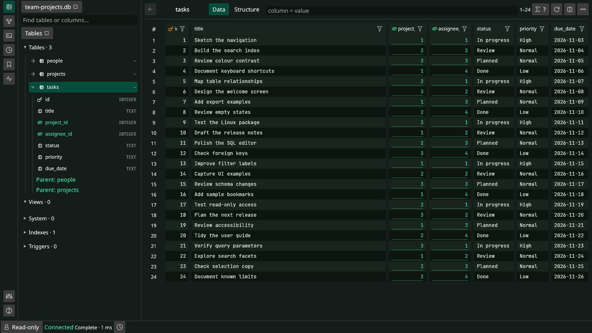
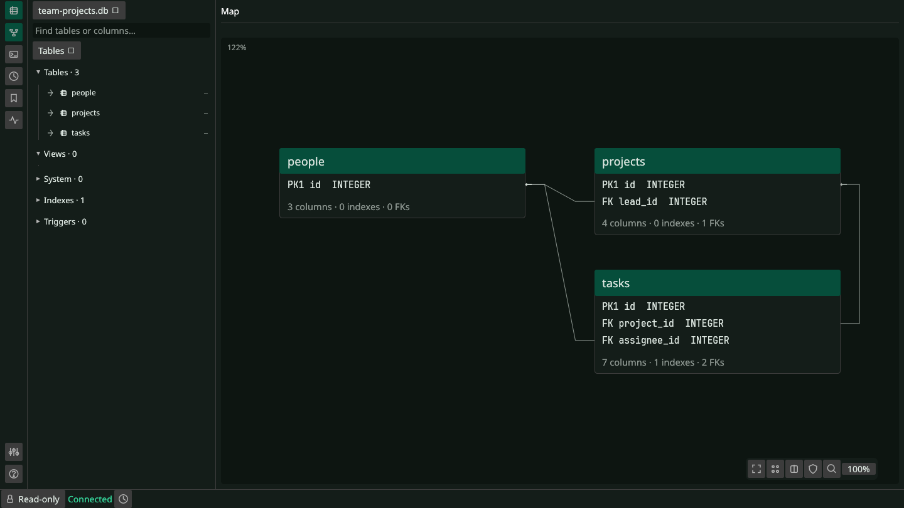
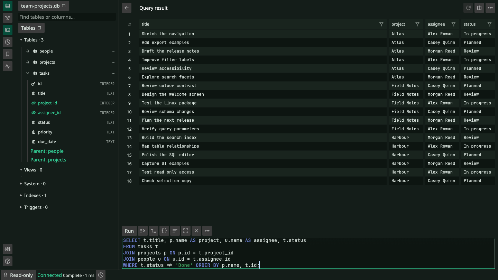

<p align="center">
  
</p>

<p align="center">
  <a href="docs/guide.md">User guide</a> ·
  <a href="CONTRIBUTING.md">Contributing</a> ·
  <a href="CODE_OF_CONDUCT.md">Code of conduct</a> ·
  <a href="SECURITY.md">Security</a> ·
  <a href="LICENSE">MIT license</a>
</p>

**TursoBench** is a local Turso database workbench.
Built with Rust and egui. Linux preview. Turso 0.8.3.

> **Independent project.** TursoBench is not affiliated with, aligned with,
> endorsed by, or maintained by Turso or the Turso team.

| 🔎 Explore | ⌨️ Query | ✏️ Edit |
| --- | --- | --- |
| Schema search, row filters, foreign-key maps. | Syntax highlighting, typed parameters, EXPLAIN, native FTS. | Staged edits, SQL preview, conflict checks. |

Read-only by default · Local history and bookmarks · JSON, CSV, TSV and SQL exports

## UI

**Table browser**



**Schema map**



**SQL editor**



*Linux. Emerald dark theme. Synthetic data.*

## Run

Requires the pinned Rust toolchain and Linux desktop libraries.

```sh
cargo run --locked -p tursobench-ui -- /path/to/existing.db
```

With Nix:

```sh
nix develop -c cargo run --locked -p tursobench-ui -- /path/to/existing.db
```

Trusted local files only. Close other database clients. Back up before writes.
No live multiprocess access, cloud sync or other engines.

[Setup and limits](docs/guide.md) · [Release status](docs/release.md)

[MIT license](LICENSE). Dependencies retain their own licenses.
See [third-party notices](third-party/README.md).
