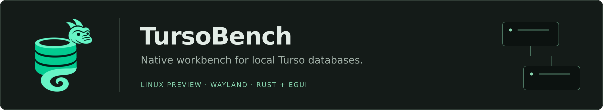
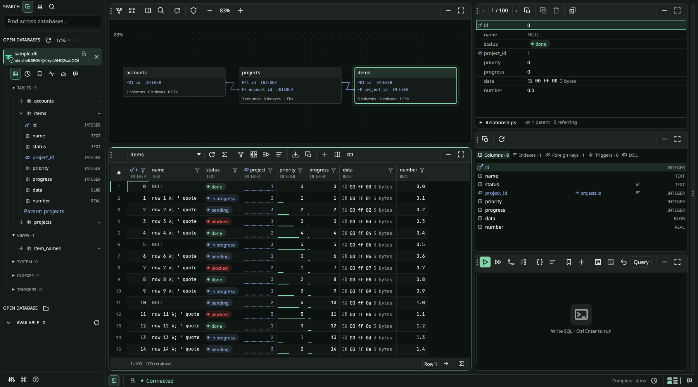
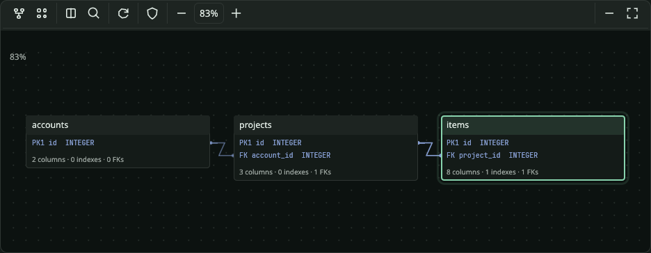
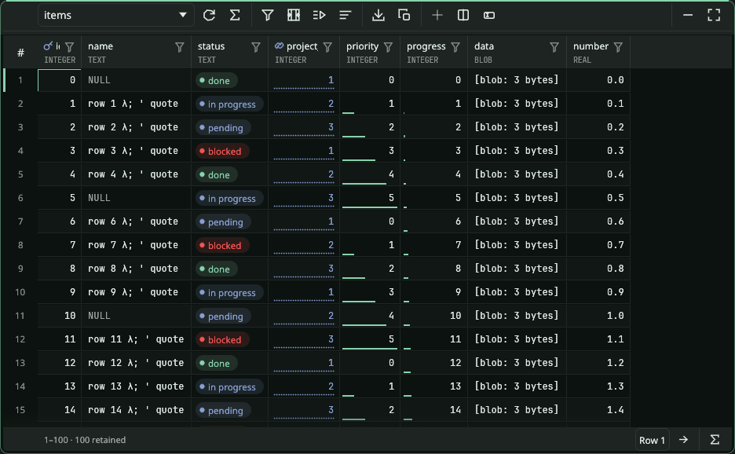
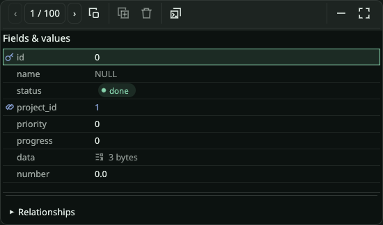
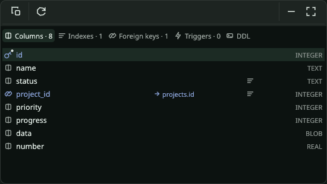
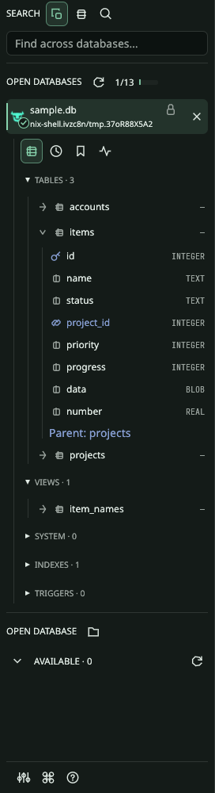

Native Linux/Wayland workbench for inspecting, querying and editing local Turso databases.
Five linked tiles combine relational navigation, typed data, schema metadata and SQL execution.

Rust 1.95 · eframe/egui 0.37 · Turso 0.8.3 with native FTS enabled.
Each database session serializes engine work on a dedicated thread with a current-thread Tokio runtime; the GUI holds no engine handles.
Access is engine-enforced read-only by default; compatible Turso peers share experimental multiprocess WAL on Linux.

## Relationships



Navigate the schema as a graph of tables, primary keys and declared foreign keys.
Selecting a table updates the linked data and inspection tiles.

Composite, self-referential and cyclic FKs are supported; relationships are never inferred from column names.
Zoom, saved map layout and a list fallback support larger schemas.

## Table data



Browse, filter and sort rows; stage cell edits, inserts, deletes and spreadsheet paste/fill operations.
FK cells navigate to related rows, while selection supports copying and numeric summaries.

Virtualized rendering and bounded fetch windows use keyset paging where supported, with OFFSET fallback.
Eligible primary-key tables commit staged edits atomically, checking original values and storage classes for conflicts.

## Record



Inspect and edit the selected row field by field, including columns hidden in the grid.
Expand Relationships to follow or count outgoing references and incoming dependants.

Record shares live rows and staged edits with Table data; NULL, text, numeric and BLOB values retain their types.
Related-row lookups use declared FK mappings, including composite keys and parent collation/affinity.

## Structure



Inspect columns, indexes, foreign keys, triggers and original DDL for the selected object.
Metadata stays linked to table selection while the tile scrolls independently.

Catalog and PRAGMA inspection expose declared types, key order, defaults and FK actions.
Schema comparison and guarded additive migration drafts are available separately through Checks → Compare schemas.

## SQL


Execute a selection, statement or script and inspect linked results within the same tile.
The editor provides syntax highlighting, completion, EXPLAIN and explicit transaction controls.

Typed positional/named JSON bindings are validated against the matching Turso parser; scripts support sequential or atomic execution.
A persistent editor connection retains transactions; separate browse reads see committed state.
Bounded result delivery and cooperative statement deadlines report execution and transaction outcomes separately.

## Database navigator



Switch between open databases, search objects and columns, and access query history, saved queries and diagnostics.
Discover local files or open an explicit path with a per-file access choice.

Each workspace retains independent drafts, results, layout and transaction state; duplicate file identities focus the existing session.
Database admission uses a configurable count and estimated memory budget; switching never silently reopens a database writable.

## Assistant


Use Claude Code, Codex or ACP agents to inspect schema, query shared data and propose SQL.
Provider/model selection and schema/result sharing controls live in the panel; the screenshot uses a seeded conversation.

MCP tools expose metadata, bounded reads and SQL proposals according to the selected sharing scope.
Queries pass parser checks and run on a dedicated `query_only` connection, capped at 200 rows / 256 KiB.
Proposed SQL opens unexecuted in the editor for explicit review and execution.

## Run

```sh
nix develop -c cargo run --locked -p tursobench-ui -- /path/to/database.db
```

Linux preview; no cloud sync or encryption. Independent project.

[Guide](docs/guide.md) · [Compatibility](contracts/engine-compatibility.md) ·
[Assistant](contracts/assistant.md) · [Captures](docs/assets/ui/README.md#readme-overview) ·
[Contributing](CONTRIBUTING.md) · [MIT](LICENSE)
