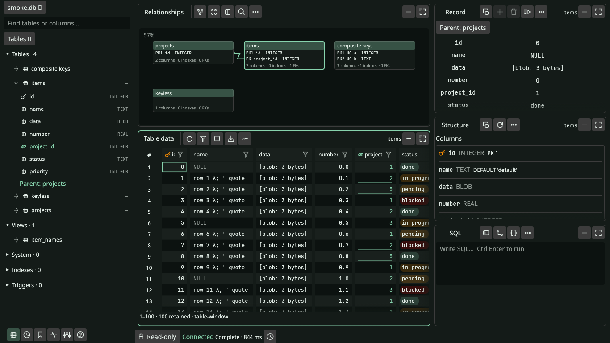
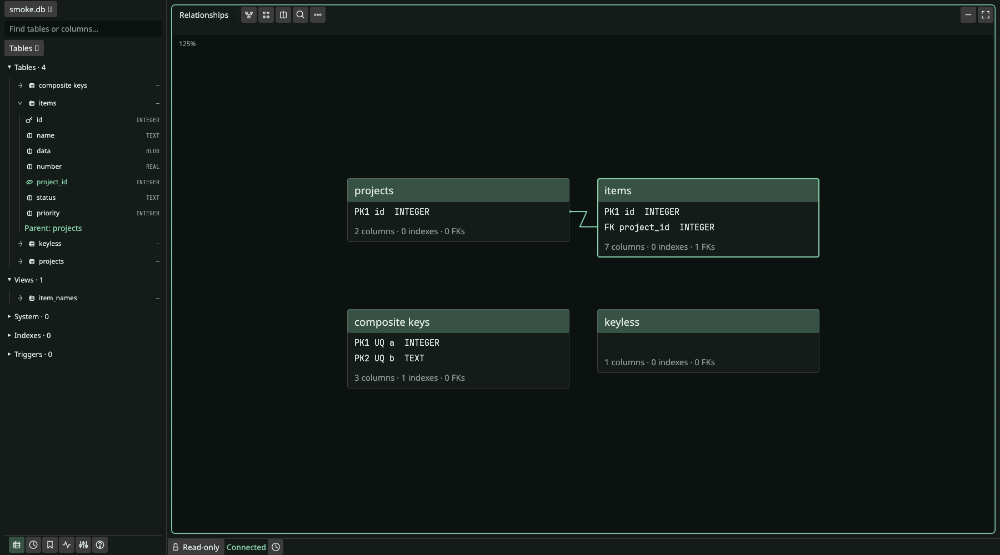
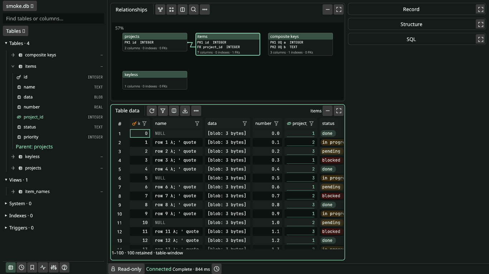
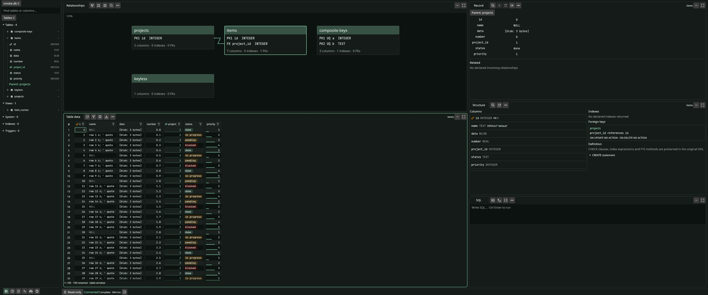

<p align="center">
  <a href="packaging/tursobench.png">
    
  </a>
</p>

<p align="center">
  <a href="docs/guide.md">User guide</a> ·
  <a href="docs/ui-redesign.md">Workspace guide</a> ·
  <a href="CONTRIBUTING.md">Contributing</a> ·
  <a href="SECURITY.md">Security</a> ·
  <a href="LICENSE">MIT license</a>
</p>

**TursoBench** is a local Turso database workbench.

Linux preview · Rust and egui · Turso 0.8.3

> TursoBench is an independent project. It is not affiliated with the Turso team.

## Workspace

Five fixed tiles share the workspace. Relationships sits above table data.
Each tile has its own toolbar. Tiles can collapse to a header.
Any tile can fill the workspace.

<picture>
  <source media="(prefers-color-scheme: light)" srcset="docs/assets/ui/v6/laptop-light.png">
  
</picture>

- Browse tables with typed filters.
- Apply filters across the whole table.
- Follow foreign-key relationships.
- Inspect columns, keys and indexes.
- Stage record edits.
- Review diffs and generated SQL.
- Commit changes explicitly.
- Run SQL with typed parameters.
- Export JSON, CSV, TSV or SQL.

Databases open read-only by default. The app follows the system theme.

## Relationships



## Minimized tiles



## Widescreen



These native captures use synthetic data.
[Capture details](docs/assets/ui/README.md).

## Run

Use the pinned Rust toolchain:

```sh
cargo run --locked -p tursobench-ui -- /path/to/existing.db
```

Or use Nix:

```sh
nix develop -c cargo run --locked -p tursobench-ui -- /path/to/existing.db
```

Omit the path to open the database chooser.

Close other database clients. Back up before writes.
Live multiprocess access is unsupported. Cloud sync is unsupported.
Discarding results does not cancel SQL execution.

[Setup and limits](docs/guide.md) · [Release status](docs/release.md) ·
[Code of conduct](CODE_OF_CONDUCT.md)

[MIT license](LICENSE). [Third-party notices](third-party/README.md).
