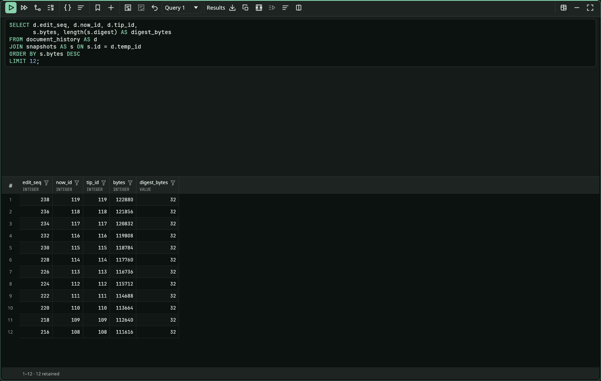
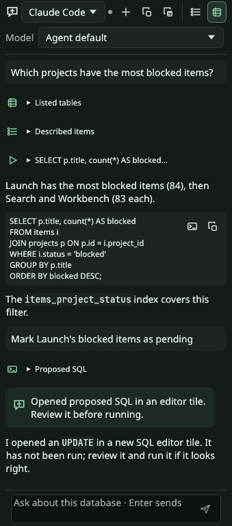

I was having an allergic reaction to JSON, and wondered what would happen if I moved to a local database.
In the spirit of Rust all the way down, I chose Turso.

Initially, I built TursoBench to keep an eye on what the database looked like.
The initial layout reflects that: relationships and tables in the middle, database details to the right, with the ability to grow any tile to the size of the workspace.

I needed to be able to push some rows into the database, so I added that function. (It's barely tested; it's not a function I need often.)

Then I added a chat interface & a more flexible layout. And then some blob viewers.

The chat drives the agent CLI you are already signed in to (Claude Code over stream-json, Codex over `codex app-server`, others over the Agent Client Protocol); TursoBench never handles credentials.
The agent reaches the database only through TursoBench's MCP tools. Each DB has a setting for what is shared, and any SQL proposed opens unrun in the SQL tile.

## Relationships


The tables, their primary keys and the foreign keys they declare, drawn as a map; nothing is guessed from column names.
Click a table and the other tiles follow it.

## Table data


The rows of the selected table, with filters, sorting and foreign keys you can follow to the parent row.
This is where rows get pushed in: edits, inserts, deletes and pastes are staged first, then committed together.

## Record


One row, field by field, including the columns that don't fit in the grid.
Each blob says what it is (image, UUID, vector, JSONB, gzip and more) and previews in place; Enter opens it in a full viewer.

## Structure


The columns, indexes, foreign keys, triggers and original DDL of the selected table.
It follows whatever is selected in the other tiles and scrolls on its own.

## SQL



An editor with highlighting, completion and EXPLAIN, with the results underneath in the same tile.
Run a selection, a statement or a whole script; transactions start and commit only when you say so.

## Assistant



A chat with the agent of your choice: one picker sets the agent, model and reasoning level. (The screenshot is a seeded conversation.)
It reads the schema and, if the database shares results, runs bounded read-only queries; anything else it can only propose.

## Run

TursoBench is a Linux/Wayland preview, built with Rust 1.95. With Nix, the pinned shell brings everything it needs:

```sh
nix develop -c cargo run --locked -p tursobench-ui -- /path/to/database.db
```

Without Nix, the same `cargo run` works with your own toolchain. Leave out the path to open a database from the sidebar instead; databases open read-only unless you ask for more.

[Guide](docs/guide.md) · [Compatibility](contracts/engine-compatibility.md) ·
[Assistant](contracts/assistant.md) · [Captures](docs/assets/ui/README.md#readme-overview) ·
[Contributing](CONTRIBUTING.md) · [MIT](LICENSE)
