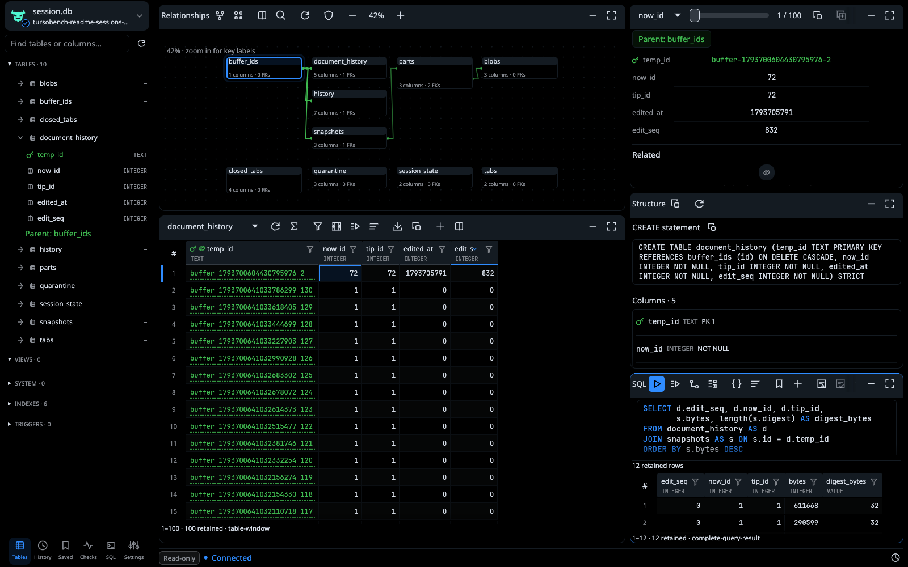
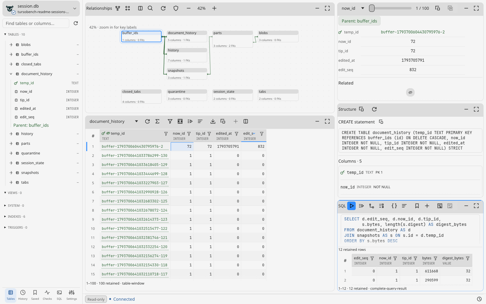
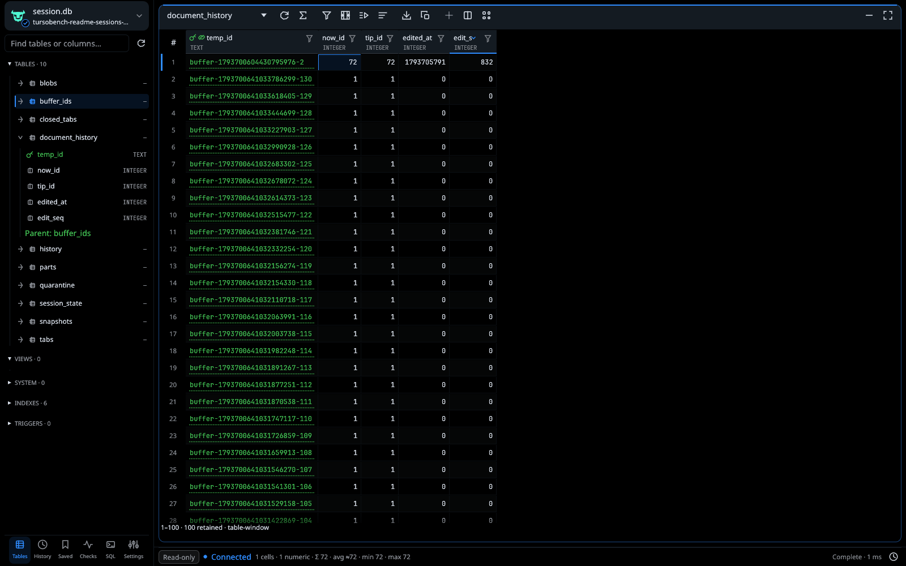
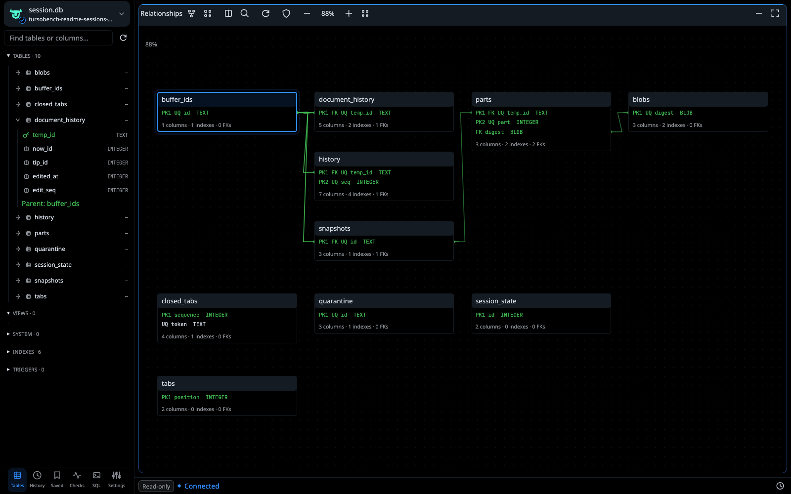
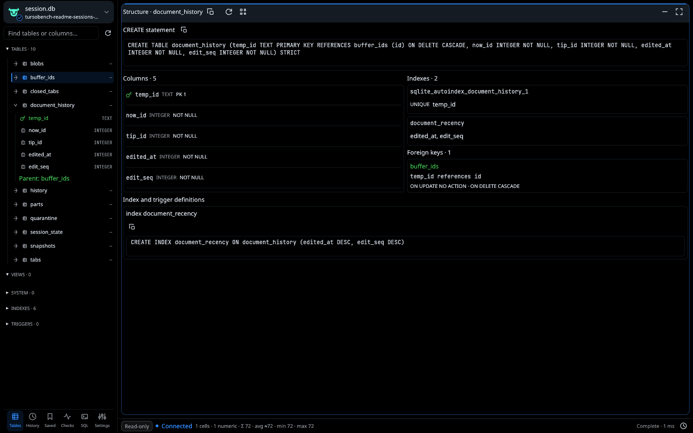
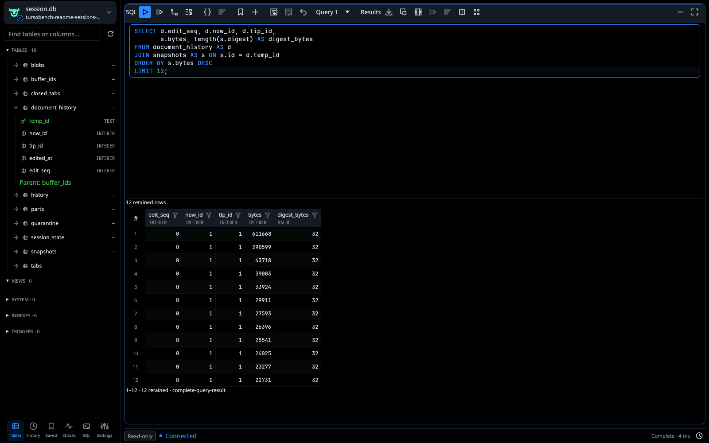

<p align="center">
  
</p>

<h1 align="center">TursoBench</h1>

<p align="center">
  <em>“These heavy sands are language tide and wind have silted here”</em><br>
  <sub>— James Joyce, <em>Ulysses</em> (“Proteus”)</sub>
</p>

<p align="center">
  <strong>A native workbench for local Turso databases.</strong><br>
  Rust 1.95 · egui 0.37 · Turso 0.8.3 · Linux preview
</p>

<p align="center">
  <a href="#workspace">Workspace</a> ·
  <a href="#browse-and-inspect">Browse</a> ·
  <a href="#sql-and-results">SQL</a> ·
  <a href="#run">Run</a> ·
  <a href="#current-limits">Limits</a> ·
  <a href="docs/guide.md">User guide</a>
</p>

TursoBench opens existing local files through Turso.
Connections default to engine-enforced read-only access.
Writes require explicit read/write access.

Independent project. Not affiliated with the Turso team.

## Workspace

Five fixed tiles share one database session.
Each tile has direct actions, horizontal ribbon scrolling and workspace expansion.
Minimize tiles without discarding filters, selections or drafts.





Screenshots use a read-only snapshot of a local session database.
[Capture provenance](docs/assets/ui/README.md#current-readme--real-session-database).

## Browse and inspect

### Table data

Browse virtualized rows in 100-row fetches.
Apply bound filters and column sorting.
Resize columns. Select ranges. Inspect typed records.
Follow foreign keys to related rows.



### Relationships

Inspect declared foreign-key edges and key labels.
Pan, zoom and arrange the graph.
Node positions persist between sessions.



### Structure

Read original DDL, declared types and constraints.
Inspect composite keys, indexes and foreign-key actions.
Copy definitions directly.



## SQL and results

Execute parsed SQL with typed named or positional bindings.
Run the buffer, selection or current statement.

```sql
SELECT d.edit_seq, d.now_id, d.tip_id,
       s.bytes, length(s.digest) AS digest_bytes
FROM document_history AS d
JOIN snapshots AS s ON s.id = d.temp_id
ORDER BY s.bytes DESC
LIMIT 12;
```



Syntax highlighting, completion and EXPLAIN are available.
CTEs, PRAGMAs and `RETURNING` are supported.
Native Turso full-text search uses `USING fts(...)` and `fts_match(...)`.
[FTS reference](docs/fts.md).

## Editing, transactions and export

Stage inserts, updates and deletes locally.
Review diffs, SQL and exact bindings.
Commit applies an atomic batch with original-value conflict checks.
Failed commits retain drafts.

Editor SQL autocommits unless a transaction is open.
`BEGIN`, `COMMIT` and `ROLLBACK` use the persistent editor connection.
Browsing uses a separate connection and sees committed state.

Export retained values as typed JSONL/JSON, annotated CSV/TSV or SQL INSERTs.
Exports exclude staged overlays.
They never rerun SQL or overwrite existing files.

## Run

Use the Nix development shell:

```sh
nix develop -c cargo run --locked -p tursobench-ui -- /path/to/session.db
```

Or use the pinned Rust toolchain:

```sh
cargo run --locked -p tursobench-ui -- /path/to/session.db
```

Omit the path to open the chooser.
Linux requires OpenGL and X11 or Wayland.
Use the desktop file picker or enter a path directly.
Open never creates a database.

## Current limits

- **Exclusive local access.** Close other clients. Back up before writes. No live multiprocess use, cloud sync or encryption.
- **Turso only.** SQLite headers indicate possible compatibility. No alternative engine is selected.
- **Bounded delivery.** Queries default to 1,000 rows, 8 MiB per result and 64 KiB per cell. Engine memory is not bounded.
- **OFFSET paging.** Browsing is not snapshot-consistent. Deep offsets may be slow.
- **Explicit writes.** Generated edits require suitable primary-key base tables. Arbitrary results, keyless tables, `WITHOUT ROWID` tables and generated columns remain read-only.
- **Execution continues.** Discard suppresses delivery. It does not cancel SQL or roll back writes. Close waits for execution and rollback acknowledgement.

[Compatibility](contracts/engine-compatibility.md) · [Editing contract](contracts/editing.md) · [Release gates](docs/release.md)

## Build and verify

```sh
nix develop
cargo fmt --all -- --check
cargo clippy --workspace --all-targets --locked -- -D warnings
cargo test --workspace --locked
cargo build --locked -p tursobench-ui
bash scripts/desktop-smoke.sh
bash scripts/discovery-smoke.sh
bash scripts/local-project-smoke.sh
```

Tests cover typed execution, transactions, editing, worker ownership and UI behavior.
Native smoke tests use Xvfb/Mesa.

[User guide](docs/guide.md) · [Workspace guide](docs/ui-redesign.md) · [Contributing](CONTRIBUTING.md) · [Security](SECURITY.md)

[MIT license](LICENSE) · [Third-party notices](third-party/README.md) · [Code of conduct](CODE_OF_CONDUCT.md)
