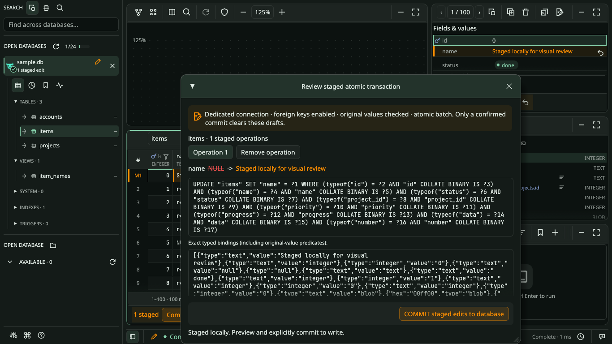

Native Linux/Wayland workbench for local Turso databases. Rust 1.95 · egui 0.37 · Turso 0.8.3.

Typed SQL bindings, bounded results, persistent transactions, virtualized tables,
DDL/FK inspection, native FTS, schema diffs, additive migration drafts,
spreadsheet paste/fill, staged atomic edits with conflict checks, and import/export.
Read-only by default; compatible local peers share access.




Claude Code, Codex and ACP assistants use consent-scoped database tools;
proposed writes require execution in the editor.


```sh
nix develop -c cargo run --locked -p tursobench-ui -- /path/to/database.db
```

Linux preview; no cloud sync or encryption. Independent project.

[Guide](docs/guide.md) · [Compatibility](contracts/engine-compatibility.md) ·
[Assistant](contracts/assistant.md) · [Captures](docs/assets/ui/README.md#readme-overview) ·
[Contributing](CONTRIBUTING.md) · [MIT](LICENSE)
