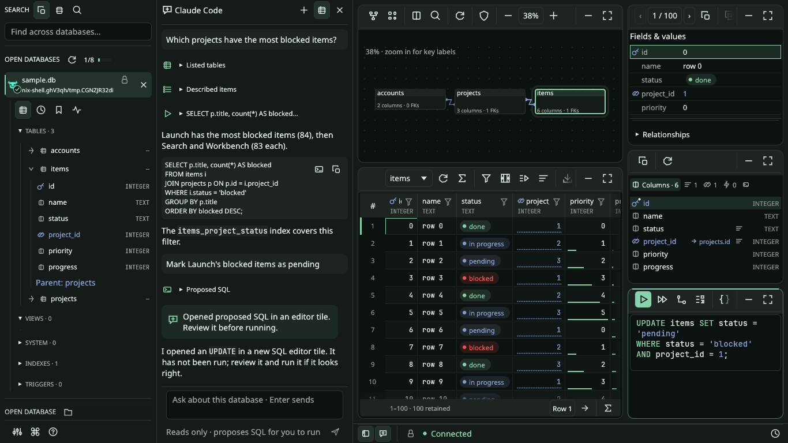

# TursoBench guide

[← Back to the README](../README.md)

A local-first **Turso-only** desktop database workbench, written in Rust with
eframe/egui and pinned to **Turso 0.8.3**. Linux preview; not a multi-engine client.

## Run

```sh
cargo run --locked -p tursobench-ui -- /path/to/existing.db
# Pinned Nix development environment (no global Cargo installation required):
nix develop -c cargo run --locked -p tursobench-ui
```

### Nix environment

`flake.nix` / `flake.lock` pin Nixpkgs and the Rust overlay. The shell reads
`rust-toolchain.toml` for Rust 1.95.0 and includes Cargo, rustfmt, Clippy,
rust-analyzer, Rust sources, a C compiler, Python, headless Weston and Wayland
desktop libraries.

Enter the environment with `nix develop`, then run Cargo normally. The legacy
`nix-shell` entry point uses the same pinned inputs and environment.

For automatic activation when entering this folder, enable direnv's hook in your
shell and approve the project's `.envrc` once:

```sh
direnv allow
cargo run --locked -p tursobench-ui
```

For Bash without an existing hook, run `eval "$(direnv hook bash)"` in your terminal
(or add it to your Bash configuration). Otherwise use `nix develop`; no direnv hook
is required. `.direnv/` is local cache data and is ignored by Git. Nix requires
`nix-command` and `flakes` enabled; the first activation may download dependencies.

Rust 1.95.0 is the tested toolchain. The default Linux build uses native Wayland,
OpenGL/EGL and libxkbcommon. Hyprland is the primary development desktop.
The preview package requires a Wayland session; it does not fall back to Xwayland.
For an X11-only compatibility build, use
`cargo run --locked -p tursobench-ui --no-default-features --features x11`.
That build also requires `libxkbcommon-x11.so.0` (`libxkbcommon-x11-0` on Ubuntu).
To build both backends, add `--features x11` while retaining the defaults.
Accessibility remains enabled; its transitive dependencies can include X11 code
even though the default app explicitly selects Wayland and has no X11 renderer.
The native file dialog requires the D-Bus runtime library
(`libdbus-1.so.3`) and an XDG portal with a file chooser backend. The Nix shell
provides the library; the desktop session provides the portal. Typing a path
works without a portal. No database is created by Open. For a disposable sample:

```sh
python3 tests/fixtures/generate.py /tmp/tursobench-sample.db
```

**Use trusted local files.** Compatible Turso 0.8.3 SDK applications can share WAL
access on Linux when they enable experimental multiprocess WAL. Other writers
are rejected through held file locks; no exclusive-use checkbox is required.
When opening a file alone read-only, TursoBench reserves access and blocks writers
until closed. The database and WAL contents stay unchanged; a `-tshm` coordination
sidecar may be created, so the folder and sidecar must be writable. Application
detection is informational and can be incomplete. See [shared access](shared-access.md).

Back up before trying writes. Do not copy only the main file of a live database.
Verified backup requires other shared connections to close and refuses publication
if it cannot reserve the source. Cloud sync, encryption and other engines remain
unsupported. Shared access is an experimental Linux preview feature.

## Features

- Startup database discovery across application data/state and development folders, with recent files, Turso/SQLite/unknown type icons, a per-file SQLite override, and search-folder controls. See [discovery behavior and limits](database-discovery.md).
- Persistent database navigator and five tiles with compact local ribbons, full-length draggable dividers, minimize-to-header and workspace expansion. Tile proportions are saved per database.
- Engine-enforced read-only opening by default; read/write is explicit opt-in.
- Searchable schema/DDL, native index/FK details, related-row navigation and read-only diagnostics.
- Relationship-arranged schema home: tables, keys, composite/self/cyclic FKs, Map/List fallback and saved map layout.
- Bounded scroll fetches, indexed/keyset paging where supported, row jumps, explicit
  total/filtered counts, multi-column sorting, grouped AND/OR and typed IN filters,
  cell filtering, sampled facets and cached FK previews.
- Virtualized results, keyboard range selection and numeric summaries, inline staged edits, typed inspection and selection copy.
- Ctrl P sidebar database/object search and Ctrl K actions; Ctrl J SQL view with highlighting, selection execution, completion and EXPLAIN.
- Single statements including CTEs, PRAGMAs and RETURNING; sequential or atomic
  run-all scripts, per-step results, convenient JSON bindings and query deadlines.
- Native Turso FTS and experimental index methods enabled: open existing FTS
  databases, create `USING fts(...)` indexes and query with `fts_match(...)`.
  See [FTS support and validation](fts.md).
- Persistent SQL-editor transactions, explicit commit/rollback, managed close.
- Local staged inserts/updates/deletes, direct explicit commit, optional SQL/binding review and atomic commits
  with optimistic conflicts. Only suitable non-engine-managed primary-key base tables are editable.
- Typed cell editing, row cloning, draft overlays and per-cell/row/operation undo.
- Timed searchable history, named database-scoped bookmarks, themes and keyboard help.
- Large text/hex viewer with chunk navigation/search and exact-byte save.
- Retained-result typed JSONL/JSON, standard or annotated/protected CSV/TSV and SQL
  INSERTs; complete table/query JSONL export, mapped imports, checkpoint and backup.

See the [UI guide and capability map](ui-redesign.md) for workspace navigation,
responsive behavior, diagram limits and validation. Relationships sits above Table data;
Record and Structure follow the selected table. SQL editors keep drafts and linked results
inside the SQL tile. Within each database workspace, views share its editor session and transaction; different database workspaces are independent.
Settings opens in one application-wide, resizable window over the workspace.
The separate Settings button, the Settings command and Ctrl+, open the same window.
Its Appearance, Discovery, Resources, Queries and Assistant pages keep the selected database tool
intact. Escape closes Settings; reopening remembers the last page during this run.
Pages are chosen from an icon rail, named on hover; below 480 px wide it becomes a row. Long pages scroll while
navigation stays visible; Discovery scrolls only its folder list.
Back restores typed filters, sorting, the retained browse window and matching row selection. Explicit
table/related counts preserve the grid and drafts; automatic counts remain deferred. Painter icons include accessible names;
native AccessKit integration is enabled. At 1280×720, the default table view shows
at least 15 complete rows when expanded.

See the [tursotui functionality review](tursotui-review.md) for changes,
shortcuts, evidence and the remaining gaps—not a claim of complete parity.

### Navigator tools

Tables, History, Saved queries and Checks work on the selected database, so their
four icons sit directly under its row in **Open databases** and appear only while
it is open. The foot of the sidebar holds application-wide controls, which also work
without an open database, as three icons: Settings (Ctrl+,), the command palette
(Ctrl K) and the keyboard reference (F1). The reference is grouped by where each
key or gesture applies, the palette lists common actions with their shortcuts, and
context menus show the matching shortcut or gesture beside each action. Hover
controls for their names.

Access mode uses the same icons throughout the app: a lock for **Read only** and a
pencil for **Read/write**, with matching tooltips and accessible names. The opening
card places the icons at the top right beside the database name and highlights the
selected mode. The status-bar icon shows the current mode;
clicking it asks for confirmation before closing and reopening with different access.

Database navigation stays in the sidebar. **Open databases** shows each live session,
its access mode (lock for read only, pencil for read/write, with tooltips), transaction
and staged-edit status, an integrated close button, and the retained/limit
meter. Selecting a row expands that database’s schema and collapses the previous tree.
Ctrl PageUp/PageDown cycles retained workspaces, including disconnected sessions
with drafts or uncertain outcomes. Switching preserves results and drafts.

The **Search** section has three scope icons with tooltips:
overlapping squares for **All open**, a database for **This database**, and a
magnifying glass for **Databases** (names and paths). The selected icon is highlighted,
and the search field hint follows the scope.
Ctrl P or `/` focuses it; arrows choose, Enter opens, and Escape clears the query.
Object results group by database; selecting one switches to its session and opens the
object. All open shows six object matches per database, with an omitted-match count.
This database filters its schema tree and matching columns. Column metadata loads for the searched sessions, with loading/errors and
metadata limits shown inline. Results stop at 100; refine the query to see others.
**Databases** matches filenames and containing paths, including files not yet open.
Ctrl K remains an actions-only palette.

The separate **Open database** section contains **Browse database files** and the
**Available** list of recent and discovered files that are not open. Select a row to
choose the lock or pencil access icon beneath it, then click **Open**. The row keeps its
place in the list; only a typed or browsed path that is not listed is reviewed above
the list. **Browse database
files** or Ctrl O opens the native file chooser; **Enter a path…** works without a portal.
Read-only is the default for a new path; likely SQLite files still require a per-file
override. Errors, recheck and retry stay in the card. Right-click a file to forget it;
Refresh reruns discovery and becomes Stop while a search is running. Configure
search folders only in Settings → Discovery. Available can be collapsed. Its list renders only
visible rows and uses cached file identities; file checks run during discovery or
explicit selection/opening. Access review reserves a workspace slot, and another workspace opens only when the configured count and memory budget allow it.

Closing a writable session with drafts or a transaction shows **Keep open** and
**Roll back & close** beneath its row. Clean sessions close directly. Cancellation
preserves the transaction and drafts. Closing a background row preserves the active
database; closing the active row selects another retained workspace. Cancelling
access review or dismissing its file picker restores the previous database. Confirmation discards local
drafts and waits for execution and rollback acknowledgement; committed writes remain.
Database switching is disabled while a file picker, close confirmation or exit is active.
Disconnected workspaces with local drafts, pending exports or uncertain outcomes remain
reachable in the sidebar. Their path cannot be edited or cleared by cancelling an open.

- **Tables:** browse the active database’s schema; refresh reloads catalog and columns.
- **History:** beside the search field, the filter icon shows only slow queries and
  the down-arrow orders by duration. Each entry is two lines: its SQL, then timing
  and any failed/slow status; a red or amber edge marks failed and slow entries.
  Click its SQL preview or editor icon to load it. Row icons stay faint until the
  pointer is over the row. Loading clears bindings and does not execute
  SQL. History is scoped to the current database. Stored SQL can
  contain sensitive values; bindings are never saved.
- **Saved queries:** enter a name and use **+** to save the current editor SQL.
  Names can be edited directly in each row. The editor icon loads SQL without
  running it and clears bindings. Search matches both names and SQL.
- The trash icon on a query row removes that entry. The trash icon in the History
  or Saved queries header clears entries **for the current database**, regardless
  of search/slow filters; its tooltip names the file. It is disabled when that file
  has no entries. Older entries with no database scope remain visible under every
  database and are preserved by this action. Remove them individually or use
  Settings → Queries → **All databases** to clear all history or all saved queries,
  including older entries. Those buttons show total counts, work without an open
  database, and are disabled at zero. Clearing is immediate, with no undo.
- **Checks:** Storage contains database files, journal mode, page count and free
  pages; Validation contains integrity and foreign-key checks. All six actions
  are read-only. They run on the browse worker and may take time; discarding result
  delivery can interrupt supported SELECT reads; statement deadlines also apply.
  Hover a check for the PRAGMA it runs; its result opens in the SQL tile. **Tools**
  lists the four windows: Compare schemas (F7), PRAGMA dashboard, Data profiling and
  Transfer & maintenance, the separate import/export/checkpoint/backup panel.
  Checkpoint and backup require writable access and editor autocommit. Backup closes
  the source and verifies the new copy before publication.
- **Settings:** Appearance groups theme, font size and the NULL display marker.
  The monitor, sun and moon select system, light and dark appearance; hover **Aa**
  for font information. Theme and font changes preview live. Settings save
  automatically: buttons and toggles immediately, drags on release, text fields
  on focus loss. Switching pages or closing the window saves pending changes.
  Queries groups row limits, Slow ≥, busy wait, deadline, SQL recovery and the
  all-databases clearing actions. Refresh marks identify values that apply after
  reopening a database: busy wait and deadline; zero deadline disables that limit.
  Slow ≥ controls history's slow filter and labels. The NULL marker changes display
  only. Discovery contains all [search-folder controls](database-discovery.md).
  Resources contains the database-count slider and memory estimate. See the
  [native Settings captures](assets/ui/README.md#application-wide-settings--native-wayland).

Parameters accept native JSON such as `[1,"a",null]` or `{":id":42}`, and tagged
values for explicit types/blobs (cell editing also has a typed form), for example:

```json
[{"type":"Integer","value":42},{"type":"Null"},{"type":"Blob","value":[0,255]}]
```

For `:id`, use an object: `{":id":{"type":"Integer","value":42}}`.
Named keys retain their `:`, `$` or `@` prefix; do not mix named and positional placeholders.

The insert form offers Default/Omit, NULL and typed Value per column. Optional
insert JSON uses one entry per column: JSON `null` omits that column (DEFAULT);
`{"type":"Null"}` explicitly inserts SQL NULL. Drafts never write until COMMIT.
Query parameters are not persisted. History **does** store SQL literals: clear
history if they contain sensitive information.

### Spreadsheet editing

Use the **Edit cells** icon at the end of the Table data ribbon, or right-click a cell, for paste, mapped new-row
paste, typed fill, NULL and undo actions. These require the same complete,
writable primary-key table browse as ordinary cell edits. SQL results remain
read-only. All changes stay local until explicit Commit.

- **Ctrl+V** pastes a tab-separated rectangle at a single selected starting cell,
  or replaces a selected rectangle of exactly the same dimensions. It follows the
  visible column order, skips hidden columns and never spills beyond retained rows
  or visible columns. Numeric and blob destinations use their current storage type;
  NULL destinations use the declared column type. Invalid input rejects the whole
  paste without changing existing drafts.
- **Paste as new rows…** (also **Ctrl+Shift+V** while the grid has focus) opens a
  clipboard input. Paste with Ctrl+V, then choose **Preview clipboard**, map each
  source column to a destination or Skip, and choose its value type. Each destination
  may be mapped once. There is no header row; unmapped table columns use defaults.
  **Stage entire paste** validates every row and the combined edit batch before
  staging any of it. Engine constraints remain checked atomically on commit.
- **Fill selected cells…** applies one explicit typed value to the visible selected
  cells. **Set selected cells to NULL**, or grid **Backspace**, stages SQL NULL.
  Rows already staged for deletion must be reverted before pasting or filling.
- **Ctrl+Z**, while the grid has focus, undoes one local edit operation. A whole
  paste or fill is one operation, preserving earlier drafts. Undo retains up to
  32 checkpoints within 16 MiB per view; it never undoes committed writes.
  Discard, refreshed results and closing the session clear the history.

Clipboard fields support quoted tabs/newlines and doubled quotes. An unquoted
`\N` means SQL NULL; `"\N"` means literal text. Empty fields, including `""`,
mean empty text, never NULL or zero. Integer parsing is exact; reals must be finite;
blobs use hexadecimal pairs without a prefix. Selected-cell copying uses the same
conventions, including quoting empty text and literal `\N`, for round trips.
Clipboard input is limited to 2 MiB, 1,000 rows and 10,000 cells. The existing
1,000-operation / 8 MiB batch and per-cell limits still apply. Inline editors,
SQL editors and dialog text fields retain their normal text paste/undo behavior.

### Assistant

The assistant chats about the open database using the agent CLI you already
installed and signed in to, so it runs on your existing plan. Claude Code is the
default; Settings → Assistant can switch to Codex (through `codex app-server`,
with its shell and web search off and its read-only sandbox on), Copilot CLI or
any other Agent Client Protocol command, and can set a model. TursoBench never
handles your sign-in: if the agent reports it is signed out, run its CLI (for
example `claude`) in a terminal.

The assistant panel sits on the left beside the sidebar. Show or hide each one
with the two icons at the left of the status bar, Ctrl B (sidebar) and Ctrl I
(assistant), or the command palette. Either, both or neither can be visible, and
the choice persists. Ctrl P search and close confirmations bring a hidden sidebar
back.

Each database asks once what to share: **Schema only**, or **Schema and query
results**. Change it with the icon in the panel header, or forget it in Settings.
The agent can list tables, describe one, run one read-only SELECT of at most
200 rows when results are shared, and propose SQL. Proposed SQL, and any SQL block
in a reply, opens in a new SQL editor tile without running; you review and run it.
Enter sends, Shift Enter adds a line and Stop interrupts the turn.

Settings → Assistant → Privacy holds each agent's own privacy choices, all
private by default: telemetry and error reports blocked, nothing saved to the
CLI's history, and whether the agent may learn the database's file name (never
its folder). It also lists what always holds, such as your sign-in and account
details never reaching TursoBench. Copilot CLI and other ACP agents keep their
own telemetry and history settings. The consent card links there.



See the [assistant contract](../contracts/assistant.md) for what is sent, the
read-only guards and process lifecycle.

## Preferences storage

Settings, history, saved queries and workspace layouts are stored in the local
Turso database `~/.config/tursobench/preferences.db` (under `XDG_CONFIG_HOME` when
set). Saves run on a dedicated worker and retain the previous snapshot in the same
transaction. Existing JSON preferences are left untouched and are not imported.
See [storage details](data-formats.md) for the schema, limits and recovery behavior.

## Important limits

Discard can interrupt a supported SELECT/EXPLAIN read; writes and RETURNING finish
when output is discarded. A cooperative engine deadline defaults to 30 seconds.
Neither discard nor timeout proves rollback. Unknown outcomes block further
mutations until reopen and inspection. Engine allocations remain unbounded: a huge
cell/query can exhaust memory even with bounded application retention.

Default query retention is 1,000 rows / 8 MiB / 64 KiB per cell. Oversized values
use bounded anonymous backing: 64 MiB/value, 256 MiB/session and 1,024 handles with
expiration. The viewer searches its current chunk; expired/unavailable originals
cannot be exported or used for optimistic edits. Table pages request at most
100 rows / 512 KiB; row retention has a 200-row minimum and reserves pending work.
Keyset paging requires a suitable non-null PK; other queries use OFFSET. Paging
is not a snapshot, and deep OFFSET fallback can be slow. Committed writes mark
other retained views stale; refresh before paging or staging again.

The SQL command bar has two execution icons: **Run** uses the selection/current
statement (also Ctrl+Enter), and **Run all** opens the sequential/atomic script
choices for the whole buffer. EXPLAIN uses the same selection as Run.
Run all offers sequential stop-on-error or atomic policy, up to 100
statements / 1 MiB. Atomic scripts cannot contain transaction controls or join an
existing editor transaction. See each step's outcome for prior committed effects.

Click a header to sort, again to reverse and once more to clear; a hovered header
previews the sort arrow. Shift-click a header adds another sort column, and each
sorted header then shows its position. Filters support grouped AND/OR and
IN lists with typed values; quote a numeric string to compare as text. Counts and
row jumps are explicit: type a row number and press Enter, or use the arrow. Typed inserts and bulk selection deletion remain local
until staged COMMIT. Arbitrary query results, keyless tables, WITHOUT ROWID and
hidden/generated columns remain ineligible for generated edits.

Transfers are separate from retained-window exports. Complete query export runs
SQL once and writes a new typed JSONL file; it never silently reruns a retained
result. Imports preview explicit mappings/types and offer atomic or confirmed
batch commits. Standard CSV/TSV preserves values with a normal header; choose
spreadsheet protection explicitly if wanted. Writable opening can migrate the
journal to WAL, as disclosed before opt-in. No automatic checkpoint or repair.

This is a working preview, **not a production safety certification**. See
[compatibility evidence and unpassed gates](../contracts/engine-compatibility.md),
[backend contract](../contracts/backend.md), [editing contract](../contracts/editing.md),
[exports/storage](data-formats.md) and [release status](release.md).

## Validate and package

```sh
cargo fmt --all --check
cargo clippy --workspace --all-targets --locked -- -D warnings
cargo test --workspace --locked
cargo run --locked -p engine-spike
cargo build --locked -p tursobench-ui
bash scripts/desktop-smoke.sh  # requires Python 3, Weston, timeout and Mesa
bash scripts/discovery-smoke.sh  # startup scan with an isolated home and disposable files
bash scripts/local-project-smoke.sh  # exact local-project schemas; synthetic data only
bash scripts/package-linux.sh
bash scripts/package-smoke.sh  # install/run the trusted archive in a temporary prefix
```

The smoke test uses 100,000 disposable rows, an isolated preferences directory,
and a real Wayland renderer under headless Weston. All native smoke and capture
scripts use `scripts/wayland-run.py`: a private compositor/socket, software GL,
no X display and an assertion against the app's actual display handle. Its
compositor/client logs remain under `target/wayland-smoke/`, including on failure.
Native Hyprland checks complement CI; see the [desktop checklist](desktop-smoke-test.md).
Packages contain a binary, desktop launcher, documentation, lockfile and dependency
license inventory/texts. Build on the intended Linux distribution; a Nix-linked
binary is not a portable Linux tarball. macOS/Windows packages are not promised.

MIT licensed. No tursotui code or tests have been copied. Dependencies retain their
own licenses; consult generated package notices before redistribution.

### SQL recovery

Settings → Queries → Recover SQL documents enables debounced saves of SQL text, document order
and cursor selections. Recovery is separate from preferences, in `sql-recovery.json`
under the application configuration directory (32 MiB total, 64 database entries,
16 documents per database, 1 MiB SQL per document). Reopen a database explicitly to
restore its editors; nothing executes and parameter values/results/table edits are
never saved. SQL literals may contain sensitive information. Disable saving or clear
saved recovery in Settings → Queries. Clearing preserves live editors; subsequent edits can
be saved again. Errors remain visible in Settings and preserve the last good save.
Only one application instance can write recovery at a time. A damaged/newer recovery
file is preserved and disables saving until it is moved aside while the app is closed.

### Context completion

Ctrl Space uses cached table/view names and inspected schema-map columns. It resolves
FROM/JOIN aliases, qualified columns and CTE names (explicit column lists, simple
projections and AS aliases), including nested scopes and correlated references.
Identifiers are quoted on insertion. Complex expression/derived-table output names
remain unresolved; prefix keyword/name completion remains available. Completion does
not execute SQL or fetch schema on each keystroke; refresh schema after external DDL.

### Query-plan diagnostics

EXPLAIN opens a collapsible plan tree with scan, indexed-lookup and temporary-sort
notes. Raw rows and bytecode remain available; unknown/cyclic plan shapes retain
raw output. For simple single-table equality filters (optionally followed by a
simple ascending ORDER BY), the tree can offer an index draft using cached metadata.
Existing ordinary indexes are checked. Complex joins, expressions and collations
remain manual. Open a draft in the editor to review and execute explicitly, then
compare plans; suggestions do not establish a runtime improvement.

### Data profiling

Checks → Data profiling opens table/column selection. Generate an exact profile or
an explicitly labeled prefix sample (default first 10,000 rows, up to 100,000).
Choose one column or all visible columns on tables up to 24 columns wide. Results
include actual rows examined, NULLs, distinct non-null values, completeness, min/max,
numeric counts/average/floating-point sum, text lengths and top-five frequencies.
Standard deviation is shown only when supported; otherwise its row explains that
limitation. Mixed-type aggregates use numeric/text values as labeled. Empty-table
ratios are NULL. Samples are not random and cannot establish whole-table uniqueness.
Profiles use committed browse state, deadlines, discard and normal result budgets;
changes mark retained profiles stale. Refresh explicitly. Sampling bounds retained
source rows, not engine memory; exact distinct/frequency scans may be expensive.

### Administration dashboard

Checks → PRAGMA dashboard reads effective editor/browse/database settings and main,
WAL and coordination-file sizes. Unsupported settings remain visible with individual
errors. Refresh explicitly; sizes are a filesystem snapshot, not a consistent backup.
The bounded editor busy timeout (0–5000 ms) and cache size (64–65536 KiB) controls
require writable access and editor autocommit. Apply reads effective settings back;
values reset on reopen and do not change saved connection defaults. Busy timeout is
editor-local; cache capacity can affect the shared pager. Foreign-key enforcement is
not disabled. Checkpoint and verified backup reuse the existing maintenance panel.

### Multiple database workspaces

Open database now opens a separate workspace while preserving the current database.
Workspaces retain independent sessions, SQL documents, results, layouts,
transactions and staged edits. Use sidebar rows or Ctrl PageUp/PageDown to switch;
Ctrl P searches across open databases or within the selected scope. Duplicate
paths, symlinks and file identities focus an existing session. New opens still require
access review and default to read-only. Close database closes only the selected session.
Application exit waits for every session/export and retains writable-close confirmation;
uncertain outcomes pause exit. Inactive requests continue draining to their owning views.
Each workspace retains the existing 16-view limit and per-session quotas.
Settings → Resources controls overall admission. No database is
silently reopened writable after restart. Connection-local state never crosses database workspaces.

### Database count and memory budget

Settings → **Resources** has one slider for the maximum number of databases
and shows the estimated memory needed at 512 MiB per workspace. Moving it updates both
the admission count and its memory allowance, saves on release and persists across
restarts. For example, selecting six databases shows an estimate of 3 GiB.
The sidebar shows retained workspaces / effective limit.

The Undo icon restores the system recommendation, calculated using 25% of available memory
detected at startup. A tick on the slider marks the recommendation; hover it to see detected available/total RAM.
Linux detection uses `MemAvailable` and includes cgroup v2 limits for the process and
its ancestors when present. If available RAM cannot be detected, the fallback is at
most 1 GiB, also bounded by a quarter of known total RAM. The recommendation is
recalculated on each launch. The slider extends to the estimated capacity of available
memory, or an existing larger limit. Previously saved resource settings remain in
effect until the slider is adjusted or Undo is clicked.

Lowering the setting leaves current sessions, drafts and exports intact and blocks
additional opens until there is capacity. Access-mode reopening reuses its existing
workspace slot. Retained disconnected workspaces also count.
CLI opening and pending access review use the same admission check. Selecting an
already-open database remains possible at the limit. A budget below 512 MiB admits no
new workspace; Settings remains available to adjust it.

This is an admission budget using estimates. Actual engine and allocator memory can
differ, and no OS memory limit is imposed. Query, per-view and per-session quotas
continue to apply independently.

### Schema comparison and migration drafts

Checks → Compare schemas or F7 compares two open database workspaces. Choose the
**desired schema** and **target database**, then capture both. Capture reads committed
`main` schemas even when the editor has an open transaction; it never writes either
file. Tables, columns, constraints, indexes, views and triggers appear as added,
removed, modified or identical. Definitions are compared literally, so cosmetic SQL
differences can appear modified. Expand an object to inspect/copy both full definitions;
column changes and table-constraint/options changes have additional notes.

New ordinary tables/indexes/views/triggers and unconstrained appended columns offer
**Open guarded migration draft in target editor**. Review the SQL and explicitly run
it in writable mode. Run all always uses an atomic transaction for these drafts and
checks the captured target schema after acquiring the write transaction. Guarded
DDL requires explicit `main` targets to avoid temporary-object name shadowing. A changed
target rejects execution before applying statements; refresh comparison and review a
new draft. Existing editor transactions, non-additive statements and read-only access
are rejected. A failed batch rolls back; any uncertain cleanup is reported explicitly.
Each draft addresses one object; dependent objects may require a deliberate order.

Removals, inferred renames, type/constraint changes, and unsupported definitions get
manual rebuild/dependency/data-mapping guidance. They never generate destructive SQL.
Comparison is capped at 10,000 objects / 8 MiB per schema and 1 MiB per definition;
oversized/inconsistent captures fail explicitly. Filtering shows up to 200 objects,
and expanded definitions show a bounded preview with full-definition copying. Each
database snapshot is internally checked; the two databases are captured independently.
Migration drafts retain their guards only in the live workspace and are excluded from
automatic recovery/history. Refresh comparison after reopening. SQL manually copied or
saved as a bookmark is ordinary SQL without the captured guard.
